# Figure 3.1 — AKAY System Overview

> **Scope:** This is a **role-based system overview**, not a detailed consultation/referral workflow, UML activity diagram, data-flow diagram, or implementation architecture. Its main purpose is to show the user entry point, role routing, main navigation modules, and selected nested sidebar items.

## Flowchart

```mermaid
flowchart TB
    START([Start]) --> LOGIN[/Login Page/]
    LOGIN --> AUTH[Validate Credentials]
    AUTH --> VALID{Credentials Valid?}
    VALID -->|No| LOGIN
    VALID -->|Yes| ROLE{Check User Role}

    ROLE -->|BHC Staff| BHC_DASH
    ROLE -->|Admin / MHO| ADMIN_DASH
    ROLE -->|RHU Staff| RHU_DASH

    subgraph BHC["BHC Staff"]
      direction TB
      BHC_DASH[/Dashboard/]
      BHC_MENU[/Select Module/]
      BHC_DASH --> BHC_MENU
      BHC_MENU --> BHC_PAT[[Patients]]
      BHC_MENU --> BHC_HOUSE[[Households]]
      BHC_MENU --> BHC_FOLLOW[[Follow-ups]]
      BHC_MENU --> BHC_REF[[Referrals]]
      BHC_MENU --> BHC_MED[[Medicine and Supply]]
      BHC_MENU --> BHC_REPORT[[Reports]]
      BHC_PAT -.-> BHC_ALL[All Patients]
      BHC_PAT -.-> BHC_MONREQ[Monitoring Requests]
      BHC_REF -.-> BHC_SENT[Sent Referrals]
      BHC_REF -.-> BHC_WAIT[Waiting to Submit]
      BHC_MENU --> BHC_LOGOUT[Logout]
    end

    subgraph ADMIN["Admin / MHO"]
      direction TB
      ADMIN_DASH[/Dashboard/]
      ADMIN_MENU[/Select Module/]
      ADMIN_DASH --> ADMIN_MENU
      ADMIN_MENU --> ADMIN_ACC[[Accounts]]
      ADMIN_MENU --> ADMIN_FAC[[Facilities]]
      ADMIN_MENU --> ADMIN_STAFF[[Staff Assignments]]
      ADMIN_MENU --> ADMIN_REPORT[[Reports]]
      ADMIN_MENU --> ADMIN_AUDIT[[Audit Logs]]
      ADMIN_ACC -.-> ADMIN_DIR[Account Directory]
      ADMIN_ACC -.-> ADMIN_RESET[Reset Requests]
      ADMIN_ACC -.-> ADMIN_INV[Invites]
      ADMIN_MENU --> ADMIN_LOGOUT[Logout]
    end

    subgraph RHU["RHU Staff"]
      direction TB
      RHU_DASH[/Dashboard/]
      RHU_MENU[/Select Module/]
      RHU_DASH --> RHU_MENU
      RHU_MENU --> RHU_INTAKE[[Patient Intake]]
      RHU_MENU --> RHU_PAT[[Patients]]
      RHU_MENU --> RHU_HOUSE[[Households]]
      RHU_MENU --> RHU_FOLLOW[[Follow-ups]]
      RHU_MENU --> RHU_DOC[[Doctor Availability]]
      RHU_MENU --> RHU_MED[[Medicine and Supply]]
      RHU_MENU --> RHU_REPORT[[Reports]]
      RHU_INTAKE -.-> RHU_INCOMING[Incoming Referrals]
      RHU_INTAKE -.-> RHU_WALK[Walk-in Check-in]
      RHU_PAT -.-> RHU_QUEUE["Today's Queue"]
      RHU_PAT -.-> RHU_ALL[All Patients]
      RHU_MED -.-> RHU_INV[Inventory]
      RHU_MED -.-> RHU_DISP[To Dispense]
      RHU_MENU --> RHU_LOGOUT[Logout]
    end

    BHC_LOGOUT --> END([End])
    ADMIN_LOGOUT --> END
    RHU_LOGOUT --> END

    classDef terminator fill:#ffffff,stroke:#202020,stroke-width:1.6px,color:#101828
    classDef io fill:#ffffff,stroke:#202020,stroke-width:1.3px,color:#101828
    classDef decision fill:#ffffff,stroke:#202020,stroke-width:1.6px,color:#101828
    classDef process fill:#ffffff,stroke:#202020,stroke-width:1.3px,color:#101828
    classDef module fill:#ffffff,stroke:#202020,stroke-width:1.3px,color:#101828
    classDef submodule fill:#f8f9fb,stroke:#667085,stroke-width:1px,color:#101828

    class START,END terminator
    class LOGIN,BHC_DASH,BHC_MENU,ADMIN_DASH,ADMIN_MENU,RHU_DASH,RHU_MENU io
    class VALID,ROLE decision
    class AUTH,BHC_LOGOUT,ADMIN_LOGOUT,RHU_LOGOUT process
    class BHC_PAT,BHC_HOUSE,BHC_FOLLOW,BHC_REF,BHC_MED,BHC_REPORT,ADMIN_ACC,ADMIN_FAC,ADMIN_STAFF,ADMIN_REPORT,ADMIN_AUDIT,RHU_INTAKE,RHU_PAT,RHU_HOUSE,RHU_FOLLOW,RHU_DOC,RHU_MED,RHU_REPORT module
    class BHC_ALL,BHC_MONREQ,BHC_SENT,BHC_WAIT,ADMIN_DIR,ADMIN_RESET,ADMIN_INV,RHU_INCOMING,RHU_WALK,RHU_QUEUE,RHU_ALL,RHU_INV,RHU_DISP submodule
```

## Flowchart symbol rules

| Symbol | Meaning in Figure 3.1 |
|---|---|
| Oval / rounded terminator | Start and End of the high-level user session |
| Parallelogram | Login screen, dashboard screen, or module-selection input |
| Standard rectangle | System authentication action, logout action, or a displayed submodule |
| Diamond | True/false credential check or user-role branch |
| Predefined-process rectangle (double side bars) | Main module with its own detailed workflow outside Figure 3.1 |
| Solid arrow | Login/authentication/role routing, selection, or logout |
| Dashed arrow | Nested navigation relationship (main module → sidebar submodule), **not** a clinical process |

## Guardrails

- The module branches represent **available navigation choices**. Modules are **not sequential** tasks and should not be interpreted as requiring Patients → Households → Reports.
- Logout is a session action; the lines from Select Module are a visual simplification, not a restriction requiring users to return to the dashboard before logging out.
- Selected submodules are shown only where the repository sidebar explicitly defines children. Detailed report categories are intentionally excluded to keep Figure 3.1 readable.
- The credential and role decisions are conceptual user-entry steps. This overview is **not** a precise representation of Laravel middleware execution, session-token refresh, or authorization internals.
- Clinical processes such as BHC consultations, RHU diagnosis, referral feedback, and monitoring handoff belong in their **own module flowcharts**, not here.
- Main labels and selected child labels come from [`frontend/src/components/layout/sidebar/sidebarData.js`](../../frontend/src/components/layout/sidebar/sidebarData.js). The source sidebar is the reference for future label changes.
- The diagram's minimal black-and-white styling is intentionally aligned with the approved Figure 3.1 reference image rather than the production application's red-branded UI.

## Module inventory (source check)

**BHC:** Dashboard; Patients (All Patients, Monitoring Requests); Households; Follow-ups; Referrals (Sent Referrals, Waiting to Submit); Medicine and Supply; Reports.

**Admin/MHO:** Dashboard; Accounts (Account Directory, Reset Requests, Invites); Facilities; Staff Assignments; Reports; Audit Logs.

**RHU:** Dashboard; Patient Intake (Incoming Referrals, Walk-in Check-in); Patients (Today's Queue, All Patients); Households; Follow-ups; Doctor Availability; Medicine and Supply (Inventory, To Dispense); Reports.
